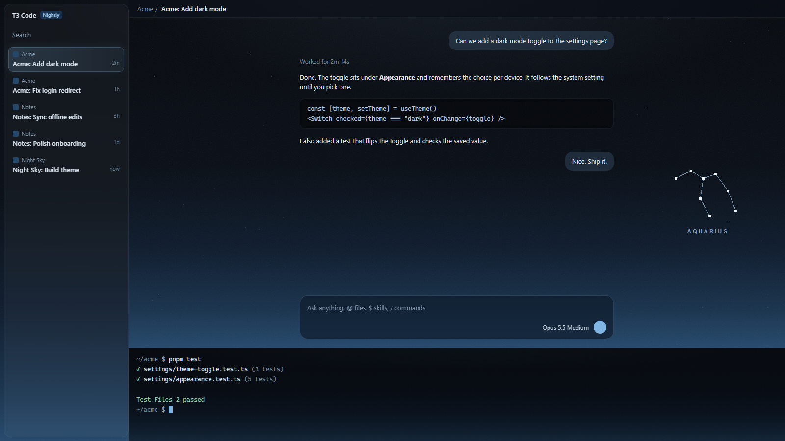

# Deep Water Stars for T3 Code

A calm night-sky theme for [T3 Code](https://github.com/pingdotgg/t3code). A deep blue gradient sits behind the whole app, faint pixel stars twinkle beside your chat, and every few seconds one of the twelve star signs draws itself line by line in the empty space next to the conversation, shows its name, and fades out again.

## Install

1. Download [`deep-water-stars.json`](deep-water-stars.json). On the file page, use the download button, or save the **Raw** view.
2. In T3 Code, open **Settings → Appearance** and click **Add a theme**.
3. Drop `deep-water-stars.json` into the box, or paste its contents, and add it.
4. Pick **Deep Water Stars** for the dark half of the color scheme, and switch T3 Code to dark mode (or System, if your OS is in dark mode).

The whole theme, including the animations, lives in that one file.

## What's in it

- **Gradient background** from near-black at the top to deep blue at the bottom, with fine grain and a soft glow from above.
- **Star signs.** All twelve, one at a time, about every 16 seconds. They stay in the space beside the chat column, so they never sit behind text, and they move with the layout when a side panel is open.
- **Pixel stars** twinkling quietly behind them.
- **Glass surfaces.** Frosted header, a floating sidebar card, a glowing selected thread, and ice-blue scrollbars and text selection.
- **Terminal.** The gradient shows through the terminal too, with a little padding around the text.

## Notes

- **Dark only.** Use it with dark mode.
- **Needs a T3 Code build with themes.** If you don't see Settings → Appearance → Add a theme, update T3 Code.
- **Web and desktop.** The mobile app doesn't use custom themes.
- **Reduced motion.** If your OS has Reduce Motion turned on, the star signs and pixel stars are hidden and only the gradient stays.
- **No network.** Everything is inline SVG with CSS animations, so nothing is fetched from anywhere.
- **Terminal colours.** T3 Code themes can't change the terminal's ANSI colours. To let the gradient show through, the theme sets the terminal background to black and blends it away, so terminal text can look slightly brighter than usual.
- **Terminal font.** Themes can't set it. Use Settings → Appearance → Separate fonts → Terminal font.

Inspired by [Pixel Quest](https://github.com/Jonathon-Sherrouse/t3code-pixel-quest).
